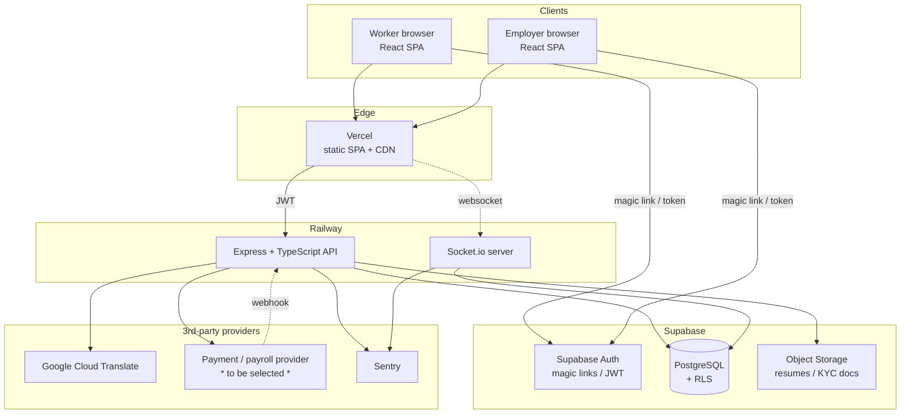

# China Talent Bridge — Architecture

**Author:** @architect
**Version:** 1.0
**Status:** Design complete — ready for @backend / @frontend / @qa / @devops
**Companion docs:** `SCHEMA.sql`, `API_CONTRACT.md`, `COMPONENT_SPECS.md`

---

## 1. Executive Summary

China Talent Bridge is a **two-sided marketplace** connecting international
companies with talent in Asia for **full-time remote employment** and
**freelance work**, plus the operational layer that follows a hire: contracts,
messaging (with translation), payroll, and billing.

The system is a fairly standard managed-PaaS web application — React SPA, a
Node/Express API, Postgres via Supabase — and the engineering risk is low. The
**real risk is regulatory**: cross-border employment, payroll into/out of
China, and personal-data transfer. Those are not solved by code; they are solved
by legal counsel and licensed partners, and they shape the product. This
document calls them out explicitly (§9) because the platform's own charter is
"legal, secure, compliant," and an architecture that ignored them would be
quietly setting the team up to fail.

The stack in `CLAUDE.md` is marked FINAL. I've **validated** it rather than
re-litigated it — it's a reasonable, coherent choice for this team and stage.
Where I'd watch for it to break, I say so.

---

## 2. System Context & High-Level Architecture



**Request paths worth noting:**

- Auth happens **client ↔ Supabase directly**; the backend only validates the
  resulting JWT. The API is stateless.
- Realtime runs as a Socket.io process alongside the API on Railway.
- Money never flows "through" us in v1 — the payment provider runs the hosted
  flow; we receive webhooks and keep the ledger.

---

## 3. Technology Decisions

The stack is FINAL; this section records **why each choice is sound and when to
revisit it**, which is what a decision log is for.

| Layer       | Choice                      | Why it fits                                                                                                                | Watch-item / when to revisit                                                                  |
| ----------- | --------------------------- | -------------------------------------------------------------------------------------------------------------------------- | --------------------------------------------------------------------------------------------- |
| API runtime | Node 18 + Express + TS      | Ubiquitous, huge hiring pool, shares types with the React app, fast to build                                               | Express is unopinionated — enforce structure (the `/services`, `/models` split) or it sprawls |
| Frontend    | React 18 + TS + Tailwind    | Standard, fast iteration, type-shared with API                                                                             | None material at this scale                                                                   |
| Database    | PostgreSQL (Supabase)       | Relational data (users↔listings↔applications↔engagements) is the right shape; Postgres gives FKs, transactions, FTS, JSONB | Connection limits under load → pool via Supavisor (§6)                                        |
| Auth        | Supabase Auth (magic links) | No password storage = smaller attack surface; offloads a hard, security-sensitive problem                                  | Magic-link UX friction; deliverability — monitor bounce rates                                 |
| Realtime    | Socket.io                   | Mature, reconnection/fallbacks built in, fits chat + presence                                                              | Single-node only until a Redis adapter is added (RISK-TECH-1)                                 |
| Translation | Google Cloud Translate      | High quality incl. zh↔en, simple API                                                                                       | **Per-character billing** — must cache + translate on demand (ADR-008)                        |
| Hosting     | Vercel (FE) + Railway (BE)  | Zero-config deploys, previews, good DX for a small team                                                                    | Three providers (incl. Supabase) = more failure seams; keep regions close                     |
| Monitoring  | Sentry                      | Error tracking across FE + BE                                                                                              | Add uptime + log aggregation + alerting separately                                            |

**Gaps the stack doesn't cover** (and must be filled): a **payment/payroll
provider**, **object storage** for documents (use Supabase Storage), a
**background job runner** for payroll/invoice generation and email (start with a
scheduled worker on Railway; revisit a queue if volume grows), and
**transactional email** for magic links + notifications.

---

## 4. Data Architecture

Full DDL is in `SCHEMA.sql`. The shape in brief:

```
profiles ──┬─ worker_profiles ── worker_skills ── skills
           └─ company_profiles ── company_members
                     │
                  listings ──┬─ freelance_details
                     │        └─ fulltime_details
                     │        └─ listing_skills
                     ▼
                applications ──► offers ──► engagements
                                              │
        conversations ── messages ── message_translations
                                              │
                 invoices ── payments      payroll_runs
                 reviews · disputes · verification_documents
                 subscriptions · notifications · audit_logs
```

**Key modeling decisions** (detailed in §8):

- **One `listings` table** for both freelance and full-time, with 1:1 detail
  tables — so applications, messaging, and offers have a single foreign key to
  point at (ADR-002).
- **`engagements` is the revenue spine** — every billable event (10% commission,
  5% annual fee, 1–2% payroll fee) derives from an engagement row, with the fee
  rates **snapshotted per engagement** so a future pricing change doesn't rewrite
  history (ADR-009).
- **Money as `NUMERIC`, time as `TIMESTAMPTZ`, enums as `TEXT + CHECK`** — exact
  arithmetic, timezone-correct for a global base, and schema that can evolve
  without `ALTER TYPE` pain (ADR-005/006/007).
- **Ledger, not wallet** — we record invoices/payments/payroll; a licensed
  provider moves the money.

---

## 5. API Architecture

Full spec in `API_CONTRACT.md`. Principles:

- **Uniform envelope** `{success, data?, error?, code?}` on every response, so
  the client has one branch point.
- **Resource-oriented REST**; the freelance/fulltime split is a `type` filter,
  not duplicated endpoints.
- **Stateless backend** — JWT-validated per request; no server sessions.
- **Cursor pagination** on all lists (stable under inserts).
- **Defense in depth** — service-layer authorization _and_ Postgres RLS.
- **Realtime via Socket.io** for messages/notifications; REST for history.

---

## 6. Security Architecture

| Concern         | Approach                                                                                                                                           |
| --------------- | -------------------------------------------------------------------------------------------------------------------------------------------------- |
| AuthN           | Supabase magic links → JWT; backend validates via JWKS                                                                                             |
| AuthZ           | Two layers: service-layer checks + **Postgres RLS** as backstop                                                                                    |
| Data isolation  | RLS on every user-data table (representative policies in `SCHEMA.sql`; full matrix is a Phase-0 @qa deliverable — RISK-SEC-1)                      |
| Secrets         | Env vars in Vercel/Railway, never committed (Principle #5); rotate provider keys                                                                   |
| PII / sensitive | KYC/KYB documents in object storage with signed URLs, **never** in Postgres; field access gated by role; consider encryption at rest for ID fields |
| Transport       | TLS everywhere; no PII in URLs/query strings                                                                                                       |
| Injection       | Parameterized queries only (Principle #4) + schema validation at the route boundary                                                                |
| File uploads    | Type/size limits + malware scan + signed, expiring URLs                                                                                            |
| Audit           | Append-only `audit_logs` for offers, verifications, payments                                                                                       |
| Abuse           | Gateway rate limiting; tighter limits on auth + mutations                                                                                          |

---

## 7. Cross-Cutting Concerns

**Internationalization & translation.** UI language from `profiles.preferred_language`.
Chat translation is **on demand and cached** (`message_translations`) — not
auto-translating every message — to control Google Translate cost and latency
(ADR-008). Same-language pairs short-circuit before any API call.

**Realtime.** Socket.io handles message delivery, read receipts, typing, and
notifications. MVP is single-node; horizontal scale requires the Redis adapter
(RISK-TECH-1).

**Payments & payroll.** The hard part. Delegated to a licensed provider; we hold
the ledger and react to webhooks. Provider selection is an Open Question with
heavy legal weight (§9, §10).

**Background work.** Invoice/commission generation, scheduled payroll runs, and
email are async — start with a scheduled Railway worker; graduate to a real
queue if volume warrants.

---

## 8. Decision Log (ADRs)

Each entry: decision · why · what we trade away · how we'd revisit.

**ADR-001 — Supabase Auth owns authentication; backend is JWT-validation only.**
_Gain:_ no password storage (smaller attack surface), faster build, fewer
security footguns. _Trade:_ coupling to Supabase; auth UX constrained to
magic-link patterns. _Revisit if_ we need SSO/SAML for enterprise employers.

**ADR-002 — Unified `listings` table with 1:1 detail tables (class-table
inheritance), not separate `projects`/`jobs` tables.**
_Gain:_ applications, offers, messaging, and search each point at one FK; no
duplicated cross-cutting logic. _Trade:_ a join to fetch type-specific fields;
slightly more complex inserts. _Considered & rejected:_ (a) two fully separate
tables — duplicates half the system; (b) one wide table with all columns
nullable — weak integrity, every query branches on type. _Revisit if_ the two
types diverge so much they share almost nothing.

**ADR-003 — Separate API surface unification: `/api/listings?type=` replaces the
original `/api/projects` + `/api/jobs`.**
_Gain:_ one set of CRUD + apply + message endpoints. _Trade:_ less semantic URL
clarity. _Note:_ this revises the original `API_CONTRACT.md`; that's the
architect's call to make.

**ADR-004 — `engagements` as a single table for employment and freelance, with a
`type` discriminator.**
_Gain:_ one revenue spine; billing/payroll/reviews/disputes all reference it
uniformly. _Trade:_ a few type-conditional fields (`comp_period` covers
annual/hourly/fixed).

**ADR-005 — `TIMESTAMPTZ` everywhere, never naive `TIMESTAMP`.**
_Gain:_ correctness across a worker in Shanghai, an employer in Berlin, and a
server in US-East. _Trade:_ none worth noting. This is non-negotiable for a
global product.

**ADR-006 — Money as `NUMERIC(14,2)` + explicit currency code; v1 normalizes
display to USD.**
_Gain:_ exact arithmetic (no float drift), currency captured. _Trade:_ a true
multi-currency ledger (FX at time of transaction, per-currency balances) is
deferred — flagged as an Open Question. _Revisit when_ we transact natively in
non-USD.

**ADR-007 — Enumerated fields as `TEXT + CHECK`, not native Postgres `ENUM`.**
_Gain:_ adding/retiring a status is a cheap constraint change, not a fragile
`ALTER TYPE` migration. _Trade:_ slightly less self-documenting at the type
level (mitigated by clear CHECK lists). Right call for an iterating MVP.

**ADR-008 — Translation is on-demand + cached, not auto-translate-everything.**
_Gain:_ Google Translate is billed per character; caching + on-demand can cut
cost by an order of magnitude and removes send-path latency. _Trade:_ a reader
clicks/await "translate" the first time for a given target language. _Revisit if_
auto-translate proves essential to UX — then pre-translate to the recipient's
language on send, still cached.

**ADR-009 — Fee rates (`commission_rate`, `annual_fee_rate`, `payroll_fee_rate`)
snapshotted on each `engagement`.**
_Gain:_ changing pricing later doesn't rewrite the economics of existing
engagements; invoices are reproducible. _Trade:_ a little denormalization.

**ADR-010 — Payments architecture is "ledger, not wallet"; money movement is
delegated to a licensed provider.**
_Gain:_ avoids becoming a money transmitter / handling raw bank+card data;
keeps PCI and FX-licensing burden with a specialist. _Trade:_ dependence on a
provider and its coverage of China payouts. _This is also a compliance control_
(§9). Provider selection is blocking for the payments phase.

---

## 9. Risk Analysis

Severity = likelihood × impact for this specific business. Compliance risks rank
highest because they are existential and under-served by the tech stack.

### 9.1 Legal & Compliance — **HIGHEST PRIORITY**

**RISK-LEGAL-1 — Cross-border employment / permanent establishment.**
A foreign company cannot simply "employ" a person in China without a local
entity, and doing so can create tax/permanent-establishment exposure. _Impact:_
the core "full-time employment" product is legally non-trivial. _Mitigation:_
operate as (or partner with) an **Employer of Record (EOR)** — a licensed local
entity that is the formal employer and handles contracts, tax, and statutory
benefits. This is a **product-shaping decision**, not a feature. **Engage
specialized employment counsel before building the employment flow.** The schema
already separates `offers`/`engagements` so an EOR layer can slot in.

**RISK-LEGAL-2 — Cross-border payroll & foreign-exchange controls.**
Moving salary into China and fees out runs into China's FX administration
regime; you can't wire funds through arbitrary channels. _Impact:_ payroll is
the operational heart and the third revenue line. _Mitigation:_ use **licensed
payment/payroll providers** with documented China payout capability (e.g.
established global-payroll/FX specialists); never build raw money transmission.
"Ledger, not wallet" (ADR-010) keeps this risk with the specialist. **Validate a
specific provider's China coverage with counsel before committing.**

**RISK-LEGAL-3 — Personal-data protection & cross-border data transfer (PIPL /
GDPR).**
China's PIPL restricts transferring PRC residents' personal data abroad
(consent, and for volume, security assessments/approvals); EU workers/companies
bring GDPR. Supabase regions don't include mainland China, so where data lives
and how it crosses borders is a real constraint. _Mitigation:_ deliberate data-
residency choice with @devops + counsel; explicit, granular consent flows; data-
minimization; documented data-subject export/delete tooling; a privacy review
before launch. The platform's "ToS reviewed / compliant" charter depends on
getting this right.

**RISK-LEGAL-4 — Identity & business verification (KYC/KYB) and sanctions.**
Payments compliance and fraud prevention require verifying workers (KYC) and
companies (KYB); some jurisdictions require sanctions screening. _Mitigation:_
the schema gates payouts on `kyc_status`/`verification_status` and stores
`verification_documents`; integrate a verification provider; screen as counsel
advises.

> The four above are why the project's "legal, no VPN evasion, official APIs
> only" framing matters: this platform is squarely on the right side of that
> line, and the way to keep it there is **specialized legal counsel plus
> licensed EOR/payment partners** — not clever engineering.

### 9.2 Security

**RISK-SEC-1 — RLS misconfiguration.** With Supabase, a missing or wrong Row
Level Security policy silently exposes data. _Mitigation:_ RLS on by default
(it is in `SCHEMA.sql`); @qa writes **policy tests** as a Phase-0 gate; review
every table before launch.

**RISK-SEC-2 — PII / document exposure.** Resumes and ID docs are sensitive.
_Mitigation:_ object storage with signed expiring URLs, never raw in Postgres;
role-gated access; upload scanning; encryption at rest for ID fields.

**RISK-SEC-3 — Secrets leakage.** _Mitigation:_ env-var-only secrets, rotation,
no secrets in logs or client bundles, scoped provider keys.

### 9.3 Technical

**RISK-TECH-1 — Socket.io single-node ceiling.** Beyond one instance, events
don't fan out without the Redis adapter, and Railway restarts drop sockets.
_Mitigation:_ fine for MVP; add `socket.io-redis` + client reconnection before
scaling out (@devops).

**RISK-TECH-2 — Translation cost/latency blow-up.** Naive auto-translate of every
message bills per character and adds send latency. _Mitigation:_ ADR-008 (on-
demand + cache + same-language short-circuit); set a budget + Google billing
alerts.

**RISK-TECH-3 — Postgres connection exhaustion.** Serverless/concurrent clients
can exhaust connections. _Mitigation:_ pool via Supavisor/PgBouncer; tune pool
size; watch slow RLS-heavy queries.

**RISK-TECH-4 — Multi-provider seams.** Vercel + Railway + Supabase + providers
= more failure points and cross-region latency. _Mitigation:_ co-locate regions;
health checks; graceful degradation when a provider is down.

### 9.4 Product / Trust & Safety

**RISK-PROD-1 — Off-platform leakage.** Both sides are incentivized to connect,
then transact off-platform to dodge the 10%/5%/payroll fees — directly attacking
the revenue model. _Mitigation:_ make staying on-platform worth more than the
fee (payroll, compliance cover, dispute protection, escrow, reputation);
detect/limit contact-info exchange pre-engagement; clear ToS.

**RISK-PROD-2 — Fraud (fake companies/workers, payment fraud).** _Mitigation:_
KYC/KYB gates, reviews/reputation, holding/escrow of funds, anomaly monitoring.

**RISK-PROD-3 — Disputes.** Cross-border, cross-language work breeds disputes.
_Mitigation:_ the `disputes` table + a defined resolution process + admin
tooling; consider milestone/escrow for freelance.

**RISK-PROD-4 — Two-sided cold start.** No workers → no employers and vice
versa. _Mitigation:_ a go-to-market concern, but architecturally keep onboarding
friction minimal and seed one side first.

### 9.5 Operational

**RISK-OPS-1 — Observability gaps.** Sentry catches errors but not uptime/logs/
business alerts. _Mitigation:_ add uptime monitoring, log aggregation, and alerts
on payment/payroll failures (@devops).

**RISK-OPS-2 — Backups & recovery.** _Mitigation:_ confirm Supabase backup
cadence for the chosen tier; test a restore; manage migrations through `/db`.

---

## 10. Open Questions (decisions the team must make)

1. **EOR: build or partner?** (legal + product) — blocks the employment flow.
2. **Which payment/payroll provider**, with verified China payout coverage?
   (legal + @devops + @backend) — blocks the payments phase.
3. **Supabase hosting region & data-residency strategy** under PIPL/GDPR.
   (legal + @devops) — affects launch.
4. **Currency strategy:** stay USD-normalized (ADR-006) or go multi-currency?
5. **Escrow / held-funds model** once a provider is chosen (affects schema).
6. **Compensation versioning** on engagements (do we need raise history?).
7. **Search scale:** Postgres FTS (in place) is fine early — set a threshold to
   reassess Algolia/Elastic.

---

## 11. Recommended Phased Delivery

| Phase                    | Scope                                                                              | Notes                                                |
| ------------------------ | ---------------------------------------------------------------------------------- | ---------------------------------------------------- |
| **0 — Foundations**      | Auth + profiles, schema + migrations, **RLS policy matrix + tests**, CI/CD, Sentry | Security backstop must exist before any data goes in |
| **1 — Marketplace core** | Listings (both types), search, applications, messaging + on-demand translation     | Delivers the discovery loop; no money yet            |
| **2 — Hiring**           | Offers → engagements, reviews                                                      | The employment/freelance relationship                |
| **3 — Money**            | Invoices, payroll, payments via provider, billing UI                               | **Gated on legal + provider decisions** (§10)        |
| **4 — Trust & scale**    | Disputes, KYC/KYB, premium subscriptions, admin tooling, Socket.io Redis adapter   | Hardening for real volume                            |

Phase 3 is intentionally late and gated — it carries the compliance weight, so
the marketplace can prove itself first while legal/provider questions resolve in
parallel.

---

## 12. Handoffs

**@backend** — Implement `API_CONTRACT.md`: uniform envelope, parameterized
queries, schema validation at route boundaries, service-layer authz _plus_ RLS,
idempotency keys on provider-touching calls. Start Phase 0/1.

**@frontend** — Build `COMPONENT_SPECS.md` against `API_CONTRACT.md`. Single
branch on `success`. Use Supabase SDK for the auth/magic-link flow directly.
Wire Socket.io for chat. Surface translation as an on-demand action per message.

**@qa** — Review `SCHEMA.sql`; own the migration set in `/db`. **Highest
priority: write the RLS policy test suite (RISK-SEC-1).** Drive >80% coverage
(Principle #2); add contract tests against the envelope.

**@devops** — Provision Supabase/Vercel/Railway with co-located regions; env-var
secrets management; Sentry + uptime + log aggregation + payment-failure alerts;
confirm backups and test a restore; add the Socket.io Redis adapter when scaling
past one node. Help evaluate payment-provider + data-residency options (§10).

---

_This document, `SCHEMA.sql`, and `API_CONTRACT.md` are living documents. I'll
revise them as the open questions resolve and as @backend/@frontend/@qa surface
constraints — flag anything that doesn't fit and I'll rework it._
